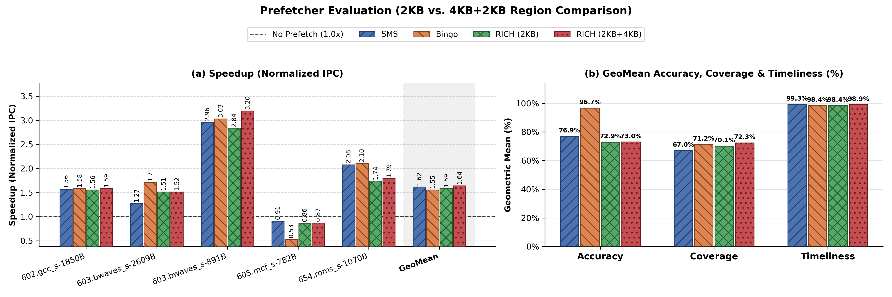

# RICH Prefetcher Implementation in ChampSim

Reimplementation and architectural evaluation of the **RICH** spatial prefetcher (**2KB** and **4KB + 2KB** memory regions) in ChampSim, compared against **No Prefetcher**, **SMS** *(ISCA'06)*, and **Bingo** *(HPCA'19)*.

---

## Table of Contents
1. [Architecture Overview](#architecture-overview)
2. [Key Files & Project Structure](#key-files--project-structure)
3. [Prerequisites & Build Instructions](#prerequisites--build-instructions)
4. [Running Experiments](#running-experiments)
5. [Generating Plots & Presentation Slides](#generating-plots--presentation-slides)
6. [Experimental Results & Key Insights](#experimental-results--key-insights)

---

## Architecture Overview

RICH extends spatial footprint prefetching by combining `PC + Address` disambiguation on small regions with multi-offset trajectory matching (`PC + 3 offsets`) on larger regions:

### 1. 2KB Region Prefetcher (`rich_region_size = 2048`, 32 cache lines)
* **Filter Table (`FT`, 64 entries) & Accumulation Table (`AT`, 128 entries):**
  * On a demand access to a 2KB region not in AT or FT, the trigger access is recorded in the FT.
  * When a **2nd distinct cache-line offset** is accessed in the same 2KB region, the FT entry is promoted to the AT to record the 32-bit spatial access bitmap.
* **Pattern History Table (`PHT`, 4096 entries, 16-way set-associative):**
  * Upon AT eviction, the recorded 32-bit pattern is indexed using both:
    1. **`PC + Address` signature** — Binds the spatial pattern to the exact data structure base address, eliminating the false-hit aliasing problem of SMS when a single loop PC iterates over multiple arrays.
    2. **`PC + Offset` signature** — Serves as a fallback when encountering unseen region addresses.

### 2. 4KB Region Prefetcher (`rich_region_4kb_size = 4096`, 64 cache lines)
* **Lookup FIFO (`LookupFIFO`, 2 entries) & Multi-Offset Trigger (`PC + 3 offsets`):**
  * Collects the first **3 distinct cache-line offsets** accessed within a 4KB page before hashing `PC + 3 offsets` to query `PHT_4KB`. Waiting for 3 offsets confirms the access trajectory and prevents false triggers when different loops begin at the same offset.
* **4KB Filter Table (`FT_4KB`, 64 entries), Accumulation Table (`AT_4KB`, 128 entries), and PHT (`PHT_4KB`, 1024 entries, 16-way):**
  * An `FT_4KB` entry collects the first 3 distinct offsets and is promoted to `AT_4KB` only when the **4th distinct offset** is accessed.
  * When evicted from `AT_4KB`, the 64-bit spatial footprint is stored in `PHT_4KB` under the `PC + 3 offsets` signature.

### 3. Prefetch Buffer
* A **320-entry FIFO prefetch buffer** queues candidate prefetch addresses generated by the 2KB and 4KB PHTs and injects up to **`rich_pref_degree = 4`** prefetches into the L2C per demand access.

---

## Key Files & Project Structure

| File / Directory | Description |
| :--- | :--- |
| `inc/rich.h` | Class definitions and data structures (`FTEntry`, `ATEntry`, `PHTEntry`, `LookupFIFO`, `RichPrefetcher`) |
| `prefetcher/rich.cc` | Core implementation of RICH (2KB & 4KB tables, signature hashing, lookup FIFO, and prefetch buffer) |
| `config/rich.ini` | Configuration file enabling the `rich` L2C prefetcher |
| `config/sms.ini` | Baseline SMS L2C prefetcher configuration |
| `config/bingo.ini` | Baseline Bingo L2C prefetcher configuration |
| `config/nopref.ini` | Baseline No-Prefetcher configuration |
| `run_experiments.sh` | Builds ChampSim and runs `nopref`, `sms`, `bingo`, and `rich` in parallel across `./traces/` |
| `run_parsec_ligra.sh` | Automated simulation script for PARSEC 2.1 and Ligra benchmark traces |
| `plot_results.py` | Parses ChampSim logs in `results/` (2KB) and `results4kb/` (2KB+4KB) to plot Speedup, Accuracy, Coverage, and Timeliness |
| `generate_ppt_slide.py` | Generates 16:9 widescreen presentation slides (`plots/*.png` and `plots/*.pdf`) |
| `results/` | Simulation outputs for the 2KB region configuration |
| `results4kb/` | Simulation outputs for the 4KB + 2KB region configuration |
| `plots/` | Generated publication-style plots and presentation slides |

---

## Prerequisites & Build Instructions

1. **Build the Bloom Filter library (`libbf`)** *(required once)*:
   ```bash
   cd libbf
   mkdir -p build && cd build
   cmake ../
   make clean && make
   cd ../..
   ```

2. **Build the ChampSim binary (1-Core, L2C multi-prefetcher)**:
   ```bash
   ./build_champsim.sh no multi no 1
   ```
   This produces `./bin/perceptron-no-multi-no-ship-1core`.

---

## Running Experiments

Place your `.champsimtrace.xz` / `.gz` traces inside `./traces/` and execute:

```bash
./run_experiments.sh
```

* **Warmup Instructions:** `50,000,000`
* **Simulation Instructions:** `200,000,000`
* Runs `nopref`, `sms`, `bingo`, and `rich` in parallel across all available CPU cores and prints a summary IPC table upon completion.

To run PARSEC and Ligra suites:
```bash
./run_parsec_ligra.sh
```

---

## Generating Plots & Presentation Slides

```bash
# Generate Speedup and GeoMean (Accuracy, Coverage, Timeliness) plots in ./plots/
python3 plot_results.py --results-2kb results --results-4kb results4kb --out-dir plots

# Generate 16:9 widescreen presentation slides in ./plots/
python3 generate_ppt_slide.py
```

---

## Experimental Results & Key Insights

Evaluated across 5 SPEC CPU2017 workloads (`602.gcc_s-1850B`, `603.bwaves_s-2609B`, `603.bwaves_s-891B`, `605.mcf_s-782B`, `654.roms_s-1070B`):

### Per-Workload Speedup (Normalized IPC over `nopref`)

| Workload | SMS | Bingo | RICH (2KB) | RICH (2KB + 4KB) |
| :--- | :---: | :---: | :---: | :---: |
| `602.gcc_s-1850B` | `1.5639x` | `1.5835x` | `1.5552x` | **`1.5882x`** |
| `603.bwaves_s-2609B` | `1.2698x` | **`1.7069x`** | `1.5148x` | `1.5155x` |
| `603.bwaves_s-891B` | `2.9624x` | `3.0306x` | `2.8393x` | **`3.1962x`** |
| `605.mcf_s-782B` | **`0.9063x`** | `0.5269x` | `0.8638x` | `0.8668x` |
| `654.roms_s-1070B` | `2.0787x` | **`2.1006x`** | `1.7401x` | `1.7884x` |
| **GeoMean Speedup** | `1.6178x` | `1.5541x` | `1.5866x` | **`1.6417x`** |

### Geometric Mean Summary Across Workloads

| Metric (GeoMean) | SMS | Bingo | RICH (2KB) | RICH (2KB + 4KB) |
| :--- | :---: | :---: | :---: | :---: |
| **Speedup** | `1.6178x` | `1.5541x` | `1.5866x` | **`1.6417x`** |
| **Accuracy (%)** | `76.91%` | **`96.69%`** | `72.92%` | `72.96%` |
| **Coverage (%)** | `66.97%` | `71.24%` | `70.11%` | **`72.34%`** |
| **Timeliness (%)** | **`99.25%`** | `98.39%` | `98.42%` | `98.92%` |

<p align="center">
  
</p>

### Key Takeaways
1. **Best Overall Speedup (`1.64x` GeoMean) & Coverage (`72.34%` GeoMean):** Adding the 4KB region table (`PC + 3 offsets`) on top of the 2KB region table captures full 64-line page footprints across 2KB boundaries, boosting `603.bwaves_s-891B` from `2.84x` to **`3.20x`**.
2. **False-Hit Elimination (`PC + Address`):** On multi-array workloads like `603.bwaves_s-2609B`, SMS aliases on `PC + Offset` (`54.5%` coverage, `1.27x` speedup). RICH's `PC + Address` signature disambiguates array base addresses, boosting coverage by **`+23.7%`** (`78.2%` coverage, `1.52x` speedup).
3. **Accuracy vs. Coverage Trade-off:** Bingo achieves high accuracy (`96.7%`) via confidence thresholds (`0.80` L2 / `0.05` LLC), but its conservative L2 filling causes severe slowdown on irregular pointer-chasing `605.mcf_s-782B` (`0.53x` vs. RICH's `0.87x`).
